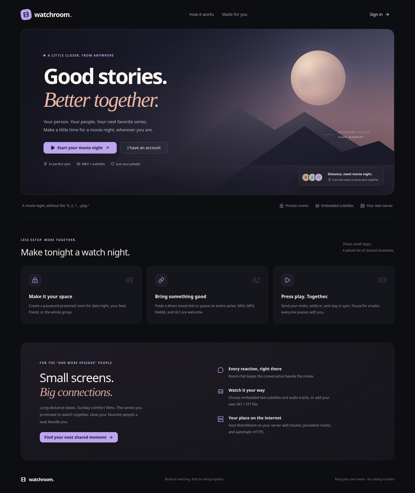

<div align="center">

# WatchRoom

### Good stories. Better together.

A private watch-together app for long-distance couples, friends, and the “one more episode” people.

React · TypeScript · Node.js · Socket.IO · SQLite · FFmpeg

</div>

Create a room, bring a direct movie or series link, and invite your people. WatchRoom synchronizes play, pause, seeking and episode changes, with room chat right beside the player.

Read the [watching guide](docs/USAGE.md) for invitations, episode queues, subtitles and common problems.



## Your movie night

- **A cozy place to watch:** responsive cinema interface, private password-protected rooms, theater mode, viewer presence, chat and quick reactions.
- **Invites that work:** copy a room invitation, sign in or create an account, then join with the room password. Invite links never contain passwords.
- **Movies and series:** add individual media links or paste an entire season into a playlist. Rooms, playlists, accounts and chat persist in SQLite.
- **Stay together:** synchronized playback, reconnect recovery, paused restart recovery, next-episode controls and an optional host-only playback mode enforced on the server.
- **MKV in your browser:** FFmpeg converts incompatible containers to HLS, copies H.264 video when possible, and converts audio to stereo AAC.
- **Your subtitles:** select embedded text subtitle tracks by language, upload local SRT/VTT files, and adjust subtitle size and timing independently of other viewers. Embedded ASS/SRT/WebVTT text is supported; bitmap subtitles such as PGS/DVD are not.
- **Your own server:** Docker Compose with persistent storage, a real outbound media firewall, non-root app processes, health checks, and an optional Caddy HTTPS profile.

WatchRoom does not supply a movie catalog or bypass DRM. Bring direct media links you have permission to share. MKV conversion currently completes before playback begins; large files and non-H.264 video can take time.

## Deploy on a server

On a fresh Ubuntu or Debian server, clone the repository and run the interactive setup:

```bash
git clone https://github.com/MohammadAliMehri/watchroom.git
cd watchroom
sudo bash deploy.sh
```

Choose a domain for automatic HTTPS through Caddy, or an IP address for HTTP. For domain setup, point DNS to your server and allow inbound TCP 80/443 in your cloud firewall before running the script. The script installs Docker when needed, validates domain DNS, configures the matching reverse proxy, builds the app, and checks both app and proxy readiness. If a step fails, it prints container status and the command to inspect deployment logs. An existing `.env` is backed up before settings are replaced. IP mode requires inbound TCP 80 and is unencrypted; use a domain for trusted TLS. The cloud provider firewall may need separate configuration.

After setup, create an account and a room, invite a second account, and confirm both viewers can exchange chat messages. See the [two-person watch guide](docs/USAGE.md) and [deployment checks](docs/DEPLOYMENT.md#before-inviting-friends).

The interactive script is the recommended public deployment path. For local development or an advanced existing reverse proxy, manual Compose configuration remains available. For automatic HTTPS with Compose, point a domain at your server, allow ports 80/443, and:

```bash
cp .env.example .env
# Edit DOMAIN and ALLOWED_ORIGINS to match your hostname.
docker compose --profile https up --build -d
```

Caddy sets up automatic HTTPS. The app retains the existing `./data` and `./media` storage paths. The container needs `NET_ADMIN` during startup to apply the media egress guard, then drops all capabilities before running Node and FFmpeg. Startup fails if protection cannot be installed.

See the [deployment guide](docs/DEPLOYMENT.md) for backups, upgrades, proxy configuration, resource requirements, and troubleshooting.

## Develop locally

Use Node.js 24 (minimum 22.13) and install `ffmpeg` / `ffprobe` on your PATH.

```bash
npm ci
npm ci --prefix web
npm start
# Another terminal:
npm run dev --prefix web -- --host 127.0.0.1
```

Open Vite on port 5173. API, media and WebSocket requests are proxied to Express on port 3000. No credentials or external database are required.

```bash
npm test               # Auth, room permissions, persistence, MKV + subtitles
npm run lint           # Frontend checks
npm run build:web      # TypeScript + production build into web/dist
npm run smoke          # Server health and frontend asset delivery
```

Express serves `web/dist` when built, falling back to packaged `public` assets. Generated builds do not modify committed bundles.

For local remote-media conversion, the explicit `ALLOW_UNSAFE_MEDIA_FETCHES=true` development override remains available. Keep that mode local and use the protected Docker deployment for a public server.

## Configuration

| Variable          | Default             | Purpose                                                           |
| ----------------- | ------------------- | ----------------------------------------------------------------- |
| `PORT`            | `3000`              | Express port; Compose publishes it on loopback only               |
| `DB_PATH`         | `data/watchroom.db` | SQLite path; Docker uses `/app/data/watchroom.db`                 |
| `MEDIA_DIR`       | `media/`            | Disposable conversion cache; Docker uses `/app/media`             |
| `ALLOWED_ORIGINS` | unset               | Allowed browser origins; set the exact HTTPS origin in production |
| `SESSION_DAYS`    | `30`                | Login session lifetime                                            |
| `DOMAIN`          | `localhost`         | Caddy hostname when the `https` profile is enabled                |

Do not manually set `MEDIA_EGRESS_PROTECTED`: the protected startup path sets it only after installing firewall rules.

## More detail

[Deployment](docs/DEPLOYMENT.md) · [Media pipeline](docs/MEDIA_PIPELINE.md) · [Architecture](docs/ARCHITECTURE.md) · [Security](docs/SECURITY.md) · [API and events](docs/API_AND_EVENTS.md)

MIT licensed. See [LICENSE](LICENSE).
