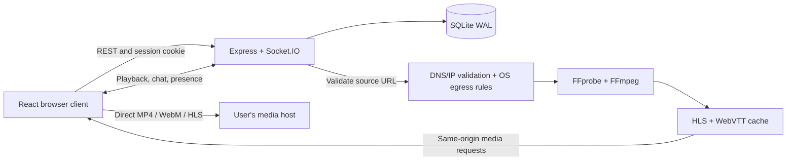

# WatchRoom architecture

WatchRoom is a single-server watch-together app for couples and friends. React renders the public landing page, accounts, rooms, player, chat and episode queue. Express, Socket.IO and SQLite run in one Node.js process; FFmpeg and FFprobe are child processes.

## Request and media flow



Direct formats are fetched by each browser. Incompatible containers such as MKV are fetched once per URL/audio selection by FFmpeg and converted on the server. WatchRoom publishes the HLS source after its first complete segment is ready, then updates the playlist while conversion continues.

## Modules

| Path                                        | Responsibility                                                                                                    |
| ------------------------------------------- | ----------------------------------------------------------------------------------------------------------------- |
| `server.js`                                 | Initialize the database, HTTP routes, session-aware socket handshake, CORS and static assets                      |
| `src/socketEvents.js`                       | Shared production/test Socket.IO registration; validate object payloads and catch asynchronous failures           |
| `src/roomManager.js`                        | Room membership, owner controls, clock snapshots, playlist transitions, media preparation and chat                |
| `src/converter.js`                          | Probe codecs, deduplicate jobs, extract text subtitles, convert HLS, cache completed results and schedule cleanup |
| `src/security.js`                           | Validate URL protocols and DNS answers; require the remote-fetch egress assertion                                 |
| `db/index.js`, `db/sqlite.js`, `db/repo.js` | Driver selection, migrations and persistence operations                                                           |
| `routes/`, `lib/`                           | Account/room REST routes, bcrypt and session tokens, input validation and auth rate limits                        |
| `web/src/hooks/useAuth.tsx`                 | Load the current session and maintain client auth state                                                           |
| `web/src/hooks/useRoom.ts`                  | Authenticated socket lifecycle, request acknowledgements, reconnect recovery and room state                       |
| `web/src/components/`                       | Landing/auth layouts, dashboard, room header, player, queue, chat and local avatars                               |

`src/db.js` and `test/watchroom.test.js` are legacy code, not the current server persistence path or the suite selected by `npm test`.

## Runtime and builds

- Node.js 24 is the Docker runtime and recommended development version. The package minimum is 22.13 because the app uses native `node:sqlite`.
- The frontend uses React 19, TypeScript 6, Vite 8, Tailwind CSS 4, Radix components, Lucide icons and HLS.js.
- `npm run build:web` type-checks the client and writes ignored `web/dist/`. Express prefers that directory; packaged Docker images copy it to `public/`. The committed `public/` assets are a legacy fallback.
- `RoomView` is loaded separately from the landing/dashboard so new visitors do not download the HLS player immediately.
- Vite proxies `/api`, `/socket.io` and `/media` to Express during development.

## Persistence and recovery

SQLite uses WAL mode, foreign keys and a busy timeout. Migrations create accounts, hashed sessions, rooms, playlist items, memberships, chat and persisted host-only settings. Existing databases with a legacy `host_only` column retain that value.

The server reloads room ownership, queue selection and saved position at startup. Restored rooms start **paused** at the saved position; downtime is not added to the movie position. The first viewer to rejoin triggers media preparation when needed. A queue with no selected item stays unselected after restart, including guest suggestions in a host-only room. Accounts, queues and the latest 200 chat messages survive restarts; live sockets and media jobs do not. The media directory is cleared on process startup.

`DATABASE_URL` can select the optional PostgreSQL driver, but `pg` is not included in the standard package/Docker installation and PostgreSQL has not been validated in this workflow. SQLite is the supported default. Multiple independent app instances are not supported: room state, rate limits and jobs are in memory, and there is no shared Socket.IO adapter.

## Synchronization and transitions

Internally the room stores a position, playing flag and reference timestamp. While playing:

```text
position(now) = currentTime + (now - updatedAt) / 1000
```

Each join/sync snapshot pairs its effective position with a **fresh snapshot timestamp**, so a client does not add the same elapsed time twice. The browser corrects drift above 1.5 seconds and matches the room's play/pause state. Browser autoplay restrictions and buffering can still require viewer interaction.

Selecting an episode clears the previous source, audio metadata and subtitles, resets the position and pauses playback. Preparing a different audio track freezes the current clock, then resumes from that position if playback was active. A per-room preparation token discards late progress, failures and results from superseded requests or deleted rooms.

Removing an earlier queued episode keeps the same current item and fixes its saved index. Removing the current item selects a surviving neighbor, paused at zero; removing the last item clears the player. In host-only rooms, guests can suggest queued media but cannot select it or remove the currently selected movie.

## Media ownership and cleanup

Jobs are shared by source URL and audio ordinal. An idle room cannot schedule deletion of a converted movie while another room still has viewers using it. Rejoining viewers cancel cleanup. Cleanup waits for a pending conversion to finish before starting its 30-minute idle timer. If cached files have already been evicted, joining the room regenerates the source.

See [media details](MEDIA_PIPELINE.md), the [wire contract](API_AND_EVENTS.md), [security boundaries](SECURITY.md) and [deployment](DEPLOYMENT.md).
